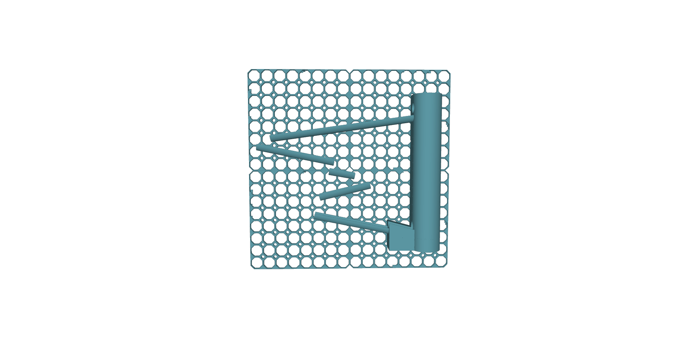

# MultiBoard Marble Track Kit!
This is a marble track made for [Multiboard](https://multibuild.io) and the [Bambu Lab Marble Kit](https://ca.store.bambulab.com/products/marble-run-components-kit-003)

## Why I made this project
I made this project because I have a MultiBoard already set up at my desk but it has close to nothing on it, and I already had a free code for the marble kit by Bambu Lab!

## How I made it
I used Tinkercad to make this model, and no problems arose!

## How to set this up for yourself!
### To set one up for yourself, you'll need:
-A MultiBoard already set up (check out [Multiboard](https://multibuild.io) for instructions)\
-The Bambu Lab Marble Kit\
-A 3D printer\
-PLA filament\
-A bunch of superglue

### How to figure out what parts you want to print:
Here's a step-by-step guide on how to set up your own:

1. Print out one bottom and one top motor casing piece/
2. Print one 10cm piece of Archimedes screw and screw casing for every 10cm of height that you want your track to go to. Make sure the pieces you print are the bottom/top/middle pieces that are meant to be printed. Don't print all of the same one, it won't fit together!
3. Slot together your casings and screws. It should be pretty straightforward, and put a drop of superglue in between each piece before assembly. Also make sure your all of your screw pieces line up and is flush with the others. It might need some light sanding.
4. Print all the necessary tracks. Your track should start at the top and go all the way to the bottom. Each track needs to be at least 20 degrees to assure that your marble rolls smoothly.
5. Place your motor in the motor casing and attach it to your screw. It should be the same assembly process as the rest of the pieces.
6. Attach your screw to your MultiBoard. To attach it, print some of the "vertical" MultiBoard attachment pieces, and place them in a vertical line on your MultiBoard. Then, put a small dab of superglue on each one and hold your screw casing on them until it stays there on it's own. They should stay straight in the track on the back of the casing. Your screw should be on the far right side of your MultiBoard, because on the left is the direction in which the marbles enter and exit the screw.
7. Add your track! Because it's on an angle and up to you where you place your tracks, there's no specific place where to put your MultiBoard attachments, so use the "horizontal" pieces, and place them wherever necessary with the same mounting method as the other attachments.
8. Test it! Place a few marbles in the bottom of the track, so they get picked up by the screw and turn on the motor. They should quickly start popping out the top and going down the track. If they're falling off the track, adjust where necessary.

Here's an example of a functioning track!

### Print the parts with these settings:
-A nozzle size of 0.4 or smaller\
-Infill of 10% or higher\
-Support at 75 degrees

## AI DISCLOSURE
NO AI was used to make this, it was made by hand in Tinkercad.

